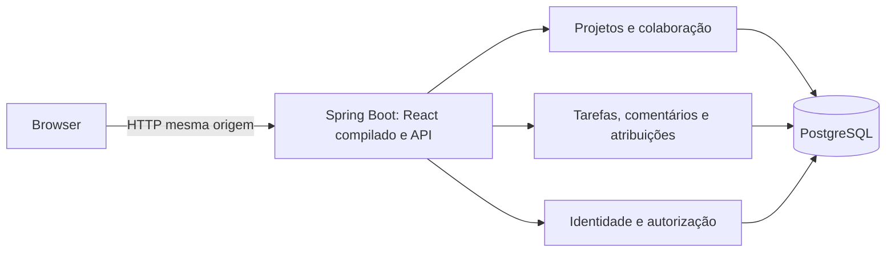

# Estado atual — versão candidata 0.1.0-rc.1

**Ficha 05, 19/11/2026.** Mantém-se a decisão ARQ-01/TEC-01; as secções anteriores preservadas abaixo descrevem a evolução. Workflow CI implementado em .github/workflows/ci.yml, validado em GitHub Actions, com evidências por SHA em verification.md.

Uma imagem de aplicação e um serviço PostgreSQL; seed é processo temporário da mesma imagem, não serviço obrigatório permanente. JPA representa entidades/valida esquema; casos de uso e consultas usam JdbcTemplate/transações. Flyway V1/V2 gere esquema, volume mantém dados. CI valida antes de construir imagens, usa Compose próprio e verifica UI/API/segurança. Sem mudança de topologia, novas entidades ou serviços. JAR final com nome estável matriz.jar; manifests indicam 0.1.0-rc.1. HTTPS/produção pública e registry não incluídos.

---

## Histórico de arquitetura

# Matriz — Arquitetura inicial do MVP

**Data:** 18/11/2026. **Decisão ARQ-01:** monólito modular, atualizado para COL-01.
**Estado:** aprovada pelo utilizador em 18/11/2026, mediante resposta “sim aprovo” à proposta ARQ-01. A aprovação abrange o monólito modular e as responsabilidades descritas; não constitui implementação. A seleção tecnológica posterior foi aprovada em TEC-01, abaixo.

## Contexto e critérios

A Matriz passou ao âmbito colaborativo integral da ficha 03 por COL-01: autenticação, autorização, projetos partilhados, responsáveis e comentários. Mantêm-se tarefas pessoais privadas, lista/Kanban/calendário, progresso e arquivo, acrescentando eliminação de projetos e pesquisa por nome.

A entrega final é em 19/11/2026 às 17h, hora de Lisboa, incluindo execução reproduzível, verificações, documentação e demonstração. Não há necessidade confirmada de escalar componentes independentemente ou distribuir o trabalho por equipas autónomas. Equipa reduzida e baixo custo operacional são premissas de desenho fornecidas para esta análise, não medições da utilização futura.

Critérios: complexidade de implementação, velocidade de desenvolvimento, manutenção, escalabilidade futura e custos operacionais. A comparação é qualitativa e relativa a este MVP; não constitui orçamento ou garantia de desempenho.

## Comparação das alternativas

Nesta comparação, monólito significa uma aplicação única organizada principalmente por camadas técnicas; monólito modular mantém a unidade de entrega, acrescentando fronteiras explícitas por responsabilidade de negócio. Um monólito pode ser bem organizado; o acoplamento não é uma consequência obrigatória do estilo.

| Critério | Monólito | Monólito modular | Microservices |
|---|---|---|---|
| Implementação | Baixa complexidade inicial; comunicação interna direta. | Baixa a moderada: exige definir poucos módulos e controlar dependências. | Elevada: comunicação em rede, vários serviços e coordenação de falhas e dados. |
| Velocidade | Arranque rápido; alterações podem atravessar várias camadas à medida que cresce. | Arranque rápido com pequeno esforço de organização; alterações ficam mais localizadas. | Menor adequação ao prazo: configuração, integração e entrega de vários serviços. |
| Manutenção | Simples no início; exige disciplina para evitar dependências dispersas. | Responsabilidades e interfaces explícitas facilitam localizar regras e testar alterações. | Mais componentes e contratos a manter; complexidade operacional desproporcionada neste contexto. |
| Escalabilidade futura | Escala-se a aplicação como um todo; separação posterior depende das fronteiras existentes. | Também escala como um todo; módulos claros facilitam reorganização ou eventual extração justificada. | Permite escalar serviços individualmente, mediante desenho e operação adicionais. |
| Custos operacionais | Tendencialmente baixos: uma unidade de aplicação para operar. | Tendencialmente baixos: uma unidade de aplicação, sem serviços distribuídos por módulo. | Tendencialmente superiores em esforço e infraestrutura para este MVP; sem valores monetários estimados. |

## Decisão arquitetural

**Foi selecionado e aprovado um monólito modular para o MVP da Matriz.**

A lógica da aplicação será organizada em poucos módulos dentro da mesma aplicação e entregue como uma unidade. Os módulos comunicam por chamadas internas com contratos explícitos, não por serviços de rede independentes. A persistência é comum à aplicação, respeitando a responsabilidade de cada módulo sobre os seus dados.

A interface é um componente da solução e não constitui um microservice. O eventual uso de uma API HTTP entre interface e aplicação não transforma os módulos internos em serviços distribuídos.

### Justificação

- **Complexidade e velocidade:** conserva uma unidade de entrega e evita descoberta de serviços, brokers e coordenação distribuída, mantendo o trabalho compatível com uma equipa reduzida e prazo curto.
- **Manutenção:** separa identidade/acesso, projetos e tarefas, com regras identificáveis para autorização, arquivo, estados e associação. Lista, Kanban e calendário reutilizam a mesma lógica.
- **Evolução:** permite acrescentar requisitos aprovados dentro de fronteiras claras. Uma futura extração de serviços exigirá necessidade demonstrada e nova decisão; não é automática nem necessária para o MVP.
- **Operação:** reduz o número de componentes que precisam de arranque, configuração e diagnóstico. O custo concreto dependerá da stack e da distribuição ainda por escolher.

Não se seleciona o monólito organizado apenas por camadas porque há regras transversais suficientes para beneficiar de fronteiras explícitas de negócio. Não se selecionam microservices porque não há requisito aprovado que compense os seus custos adicionais no prazo disponível.

## Componentes e responsabilidades — versão colaborativa

A decisão ARQ-01 de monólito modular mantém-se. COL-01 autoriza a extensão para identidade/acesso e colaboração, sem microservices.

| Componente | Responsabilidade |
|---|---|
| Interface | Início/fim de sessão, painel, projetos, tarefas, lista/Kanban/calendário, responsáveis e comentários; estados de carregamento/vazio/sucesso/erro e confirmação de eliminações. |
| Identidade e acesso | Autenticar, obter perfil, terminar sessão, fornecer identidade ao backend. Spring Security com sessão no servidor e cookie aprovados; palavras-passe locais apenas com hash por biblioteca adequada. |
| Módulo Projetos | Proprietário, colaboradores, pesquisa/listagem autorizada, edição, arquivo/restauro e eliminação de projeto/dependentes. Fonte das relações de acesso ao projeto. |
| Módulo Tarefas | Tarefas, criador, associação opcional, estados, prioridades, prazos, comentários e atribuições; autorização e elegibilidade pelo acesso atual. |
| Coordenação de casos de uso | Aplicar identidade e política, validar todos os recursos do pedido e coordenar operações atómicas entre dados dependentes, sem mover regras para controladores. |
| Consultas | Conjunto autorizado, filtros e contagens/progresso derivados; nunca contar recursos alheios ou apenas a página visível. |
| Persistência | Integridade, unicidade, referências e transações; conservação de dados após reinício; sem sucesso antes de confirmação da gravação. |
| Configuração/arranque | Execução reproduzível, migrations ou equivalente, seed não destrutivo, configuração de exemplo sem segredos e comandos verificáveis. |

Identidade/Acesso, Projetos e Tarefas são responsabilidades modulares. Comentários e atribuições pertencem a Tarefas; não exigem serviços ou bibliotecas separados. A política de acesso é transversal, com os factos de propriedade/colaboração fornecidos por Projetos, evitando dependências circulares.

## Fluxos e segurança

- O ponto de entrada autentica o pedido e transmite uma identidade confiável. Os casos de uso autorizam o recurso concreto e não aceitam proprietário/autor do cliente como identidade.
- Criar projeto infere proprietário; criar tarefa infere criador; criar comentário infere autor e data.
- Uma tarefa de projeto exige acesso atual ao projeto; independente exige criador. Comentários e atribuições herdam o acesso da tarefa.
- Atribuir responsável exige existência e elegibilidade; a associação tarefa/utilizador é única. A atribuição não concede acesso.
- Transferência verifica origem, destino e arquivo; desassociação torna a tarefa privada do criador original. Atribuições que deixem de ser elegíveis são removidas na mesma operação atómica, conforme COL-06.
- Eliminar projeto é reservado ao proprietário e remove dependentes atomicamente, preservando utilizadores e outros projetos. A interface confirma o alcance antes de enviar o pedido.
- Arquivar não apaga dados nem identidades; impede alterações às tarefas/dependentes e retira-os das vistas principais. Restauro é do proprietário.
- Listagens, pesquisas e métricas filtram autorização antes de devolver resultados. Não usar UI como única barreira.
- Dados pessoais e hashes não entram em DTOs desnecessariamente. Sem exposição pública aprovada.
- Falha de gravação não confirma alterações parciais; falha de comunicação após envio de criação é resultado desconhecido, não prova de rollback. Evitar duplicação de submissões e definir reenvio antes de implementar.

## Stack e execução aprovadas — TEC-01

**Decisão humana em 18/11/2026:** “ok vamos fechar o exercicio 1 da ficha 03 então com essa sugestão”, após revisão dos materiais do curso. A stack é uma escolha do projeto, não uma imposição dos exemplos pedagógicos.

| Área | Tecnologia aprovada | Justificação |
|---|---|---|
| Backend/build | Java 21, Spring Boot e Maven | Monólito modular com ferramentas Java/Maven disponíveis e build explícito. |
| Segurança | Spring Security, sessão no servidor e cookie | Suporta a política COL-05, autorização por recurso e integração de CSRF; não acrescentar JWT. |
| Persistência | PostgreSQL e Spring Data JPA | Modelo relacional, referências e transações para acesso/cascata/limpeza de atribuições. |
| Esquema | Flyway | Migrations versionadas/reproduzíveis; não recriar/apagar dados em cada arranque. |
| Frontend | React, TypeScript, Vite e CSS simples | Formulários e vistas com componentes reutilizáveis; evitar bibliotecas visuais sem necessidade. |
| Testes backend | JUnit, Spring Boot Test, MockMvc | Regras, contrato, autorização e fluxos de API. |
| Testes de persistência | Testcontainers com PostgreSQL | Integração com BD real isolada, independente dos dados de demonstração. |
| Testes E2E | Playwright com TypeScript | Percurso de utilizador reproduzível pedido nas fichas de QA. |
| Análise frontend | ESLint | Verificação estática ajustada à stack. |
| Execução/CI | Docker, Docker Compose e GitHub Actions | Imagens, volume persistente, healthchecks, builds e verificações reproduzíveis. |

Na entrega, React compilado é servido pelo Spring Boot: uma imagem de aplicação e um serviço PostgreSQL no Compose. Não implica microservices nem um container por módulo. Em desenvolvimento, Vite corre separadamente e pode encaminhar /api para o backend, preservando uma origem de acesso no browser.

A revisão dos 14 PDFs, 28 anexos e AI.txt confirmou que FastAPI/Python nos exemplos de DevOps não é obrigatório. Dockerfiles e CI serão adaptados para Java/Maven; não copiar comandos Pytest. AI.txt descreve um percurso separado e não acrescenta IA/RAG à Matriz.

Versões exatas de dependências/imagens, tipos físicos, política temporal da sessão e detalhes de configuração ficam fixados e verificados nos incrementos apropriados. Na data desta decisão não tinham sido instaladas dependências nem produzidos builds; a execução posterior do Exercício 2 consta de setup.md e verification.md.

## Evolução e pendências

TEC-01 resolve stack, biblioteca de segurança e tecnologias de persistência/migrations. Versões/tipos físicos e arranque foram concretizados no Exercício 2; SEG-01 e configuração de sessão no Exercício 3. Permanecem pendentes CRUD, restantes fluxos e entrega integral. Não há aprovação de JWT, microservices ou gestão de organizações.

O OpenAPI e o desenho de interface são revistos para colaboração e marcados segundo o seu estado de aprovação. O modelo individual anterior fica em history/mvp-individual-v1. Não usar essa versão para segurança ou regras atuais.

## Referências

- [Requisitos](requirements.md)
- [User Stories](user-stories.md)
- [Restrições](constraints.md)
- [Reconciliação](scope-reconciliation.md)
- [Modelo](database.md)
- [OpenAPI](../openapi.yaml)
- [Plano](implementation-plan.md)
- [Registo da ficha 3](ai-logs/ficha-03.md)

## Implementação da base — Exercício 2

Estrutura modular materializada em backend/src/main/java/pt/matriz (identity, projects, tasks e bootstrap), frontend React e execução Compose. [setup.md](setup.md) regista versões fixadas, dependências, configuração, esquema e seed. Actuator expõe apenas health sem detalhes para diagnóstico/healthcheck; não é um módulo de negócio nem uma operação adicional do contrato funcional. Docker compila React e serve os ficheiros pelo Spring Boot, como previsto em TEC-01.

O seed é um processo temporário da mesma aplicação, ativado explicitamente, com transação e lock de inicialização. Não corre no arranque normal. Não foram implementados login, autorização por recurso ou CRUD; a superfície de negócio fica bloqueada até aos incrementos correspondentes.

## Acesso implementado — Exercício 3

SEG-01 foi escolhida pelo utilizador: sessão em memória, 60 minutos de inatividade, sem lembrar-me; reinício e logout exigem novo login. Cookie/CSRF, identidade autenticada, matriz de autorização e fronteiras de leitura constam de [security.md](security.md). Não foram acrescentados JWT, serviços ou tabelas de sessão. Leituras parametrizadas reutilizam PostgreSQL e transações; DTOs não expõem entidades JPA. Oito operações disponíveis, restantes bloqueadas até ao respetivo incremento. A criação de proprietário/criador/autor e as escritas colaborativas permanecem nos casos de uso seguintes.

## Gestão de projetos — Exercício 4

Comandos transacionais ProjectCommands com identidade da sessão e lock de linha antes de editar/eliminar; listagem agregada/consulta e pesquisa PESQ-01 sobre o conjunto autorizado. FKs/cascata da V1 mantidas; sem extensões, tabelas ou tecnologias novas. UI integrada com formulários e confirmação modal. [projects.md](projects.md) descreve contrato, limites, validação e concorrência. As criações de tarefas/comentários e atribuições continuam nos exercícios seguintes; a criação de projetos já infere o proprietário no backend.

## Atualização aprovada — Exercício 5 (TAR-01/PESQ-02)

Os estados técnicos ativos passam a TODO/IN_PROGRESS/DONE (rótulos Por fazer/Em curso/Concluída), com inicial TODO; prioridades LOW/MEDIUM/HIGH (Baixa/Média/Alta) ou null. Em novas tarefas prioridade omitida = MEDIUM; null explícito = Sem prioridade. As referências anteriores aos quatro estados/prioridades ficam superadas por esta decisão humana, sem alterar cardinalidades nem remover tarefas pessoais COL-04.

A V2 incremental converte Por Fazer→TODO, Em Curso/Em Revisão→IN_PROGRESS, Concluída→DONE, Baixa→LOW, Média→MEDIUM, Alta/Crítica→HIGH; conserva prioridades null preexistentes, IDs, criador, comentários e atribuições. PESQ-02 confirma pesquisa literal parcial de tarefas ignorando maiúsculas e acentos.

Lista/CRUD/filtros e transferências de tarefas implementados com autorização, CSRF e transações; COL-06 remove atribuições inelegíveis na mesma operação. Progresso calcula tarefas DONE/total. Escrita de comentários/responsáveis, gestão de colaboradores, painel, Kanban e calendário continuam pendentes. Ver [tarefas](tasks.md), OpenAPI 0.5.0 e verification.md para o estado observado.

## Atualização — Exercício 6

Responsáveis/elegíveis e comentários integrados na API e no detalhe da tarefa, mantendo o modelo de seis entidades e V1/V2. COM-01: novos comentários de 1–2000 pontos de código Unicode, não só espaços; autor/data do backend; ordem criadoEm/id ASC. Responsáveis múltiplos com par único, remoção individual e elegibilidade revalidada no backend. Arquivo bloqueia escritas; pessoais privadas. Contratos/limites em [task-collaboration.md](task-collaboration.md). As menções anteriores a escrita de comentários/responsáveis pendente ficam superadas por este incremento; gestão de colaboradores, painel e Kanban/calendário continuam pendentes. Ver verification.md para evidências, sem confundir plano com teste executado.

## Atualização — Exercício 7

Colaboradores (US-17), painel (US-22), Kanban (US-07) e calendário (US-08) integrados na interface/API. PAINEL-01 inclui pessoais + projetos ativos acessíveis na UI, exclui arquivo, não depende dos filtros da lista. COL-07 permite ao proprietário gerir colaboradores mesmo arquivado; remoção limpa atribuições atomicamente e conserva autoria/contas. Tarefas arquivadas continuam protegidas contra escrita. Modelo/stack/V1/V2 preservados; OpenAPI 0.7.0 com 24 operações implementadas. As referências anteriores a estas funcionalidades pendentes ficam superadas por este incremento. Ver [integração](frontend-integration.md) e verification.md para resultados/limites; entrega final/CI não declaradas concluídas.
