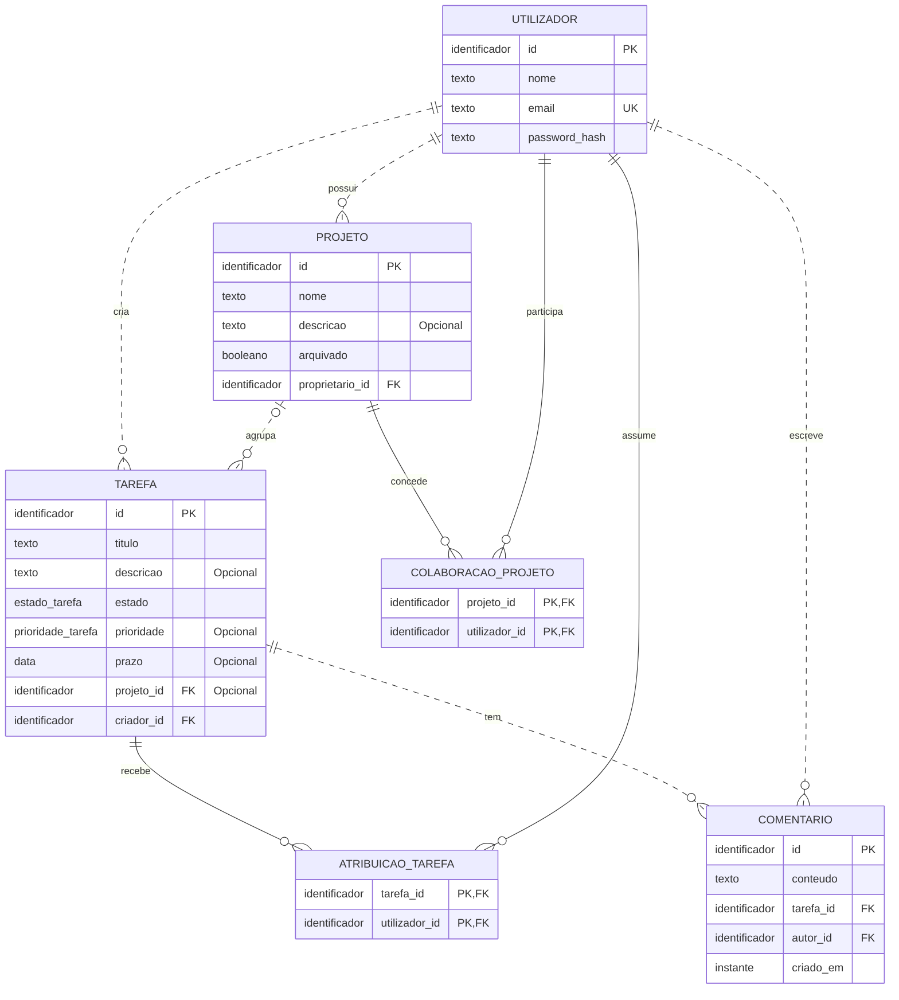
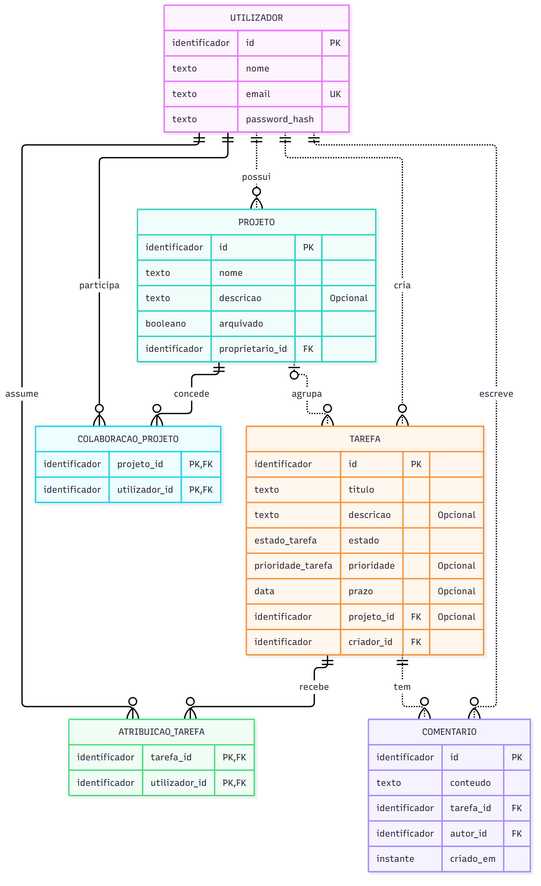

# Matriz — Modelo conceptual colaborativo

**Versão:** 2.0, 18/11/2026. DADOS-02: revisão documental por COL-01, baseada nas decisões de colaboração confirmadas. Modelo conceptual preservado. A concretização física do Exercício 2, com migration e mapeamentos JPA, está em setup.md; limites de negócio e armazenamento/política de sessões continuam pendentes.

## Entidades e atributos

| Entidade | Atributos | Integridade e origem |
|---|---|---|
| UTILIZADOR | id (PK), nome, email (único), password_hash | Contas de demonstração para autenticação local; hash nunca exposto na API. Email é o identificador de acesso proposto no contrato; detalhes de normalização/biblioteca pendentes. |
| PROJETO | id (PK), nome, descricao opcional, arquivado, proprietario_id (FK obrigatório) | Nome não vazio; arquivado=false na criação; proprietário inferido da autenticação. |
| TAREFA | id (PK), titulo, descricao opcional, estado, prioridade opcional, prazo opcional, projeto_id (FK opcional), criador_id (FK obrigatório) | Criador imutável inferido no backend. Sem projeto, só o criador tem acesso. |
| COLABORACAO_PROJETO | projeto_id e utilizador_id (PK composta e FKs) | Representa membros adicionais, não perfil global. Par único; proprietário tem acesso pela referência própria, sem precisar de colaboração duplicada. |
| ATRIBUICAO_TAREFA | tarefa_id e utilizador_id (PK composta e FKs) | Par único; exige utilizador com acesso atual à tarefa. Atribuição não concede acesso. |
| COMENTARIO | id (PK), conteudo, tarefa_id (FK), autor_id (FK), criado_em | Conteúdo não vazio/só espaços; autor e instante definidos no backend. |

Os tipos são conceptuais. Identificadores JSON são strings opacas, sem impor UUID ou texto na persistência. password_hash representa credencial já derivada por biblioteca adequada, nunca palavra-passe em claro. Sessões são infraestrutura de autenticação no servidor; não se impõe uma tabela de negócio de sessões ou guardar o identificador de sessão em claro neste modelo.

## Relações

| Relação | Cardinalidade |
|---|---|
| Utilizador proprietário → Projeto | Utilizador possui 0..N projetos; cada projeto tem exatamente um proprietário. |
| Projeto → Tarefa | Projeto tem 0..N tarefas; tarefa pertence a 0..1 projeto. |
| Utilizador criador → Tarefa | Utilizador cria 0..N tarefas; cada tarefa tem exatamente um criador. |
| Projeto ↔ Utilizador colaborador | N:M por COLABORACAO_PROJETO, admitindo zero colaboradores. |
| Tarefa ↔ Utilizador responsável | N:M por ATRIBUICAO_TAREFA, admitindo zero responsáveis. |
| Tarefa → Comentário | Tarefa tem 0..N comentários; cada comentário pertence a uma tarefa. |
| Utilizador → Comentário | Utilizador escreve 0..N comentários; cada comentário tem exatamente um autor. |

## Mermaid

[SVG](diagrams/matriz-erd.svg) · [Fonte Mermaid](diagrams/matriz-erd.mmd)

Linhas tracejadas representam relações não identificadoras quando a entidade tem chave própria. As relações das entidades associativas são identificadoras porque as referências compõem a PK.

## Regras transversais de integridade e acesso

- Todas as referências preenchidas apontam para registos existentes.
- Projeto/tarefa/comentário recebem proprietário/criador/autor da identidade autenticada; o cliente não os impõe no pedido.
- Acesso ao projeto: proprietário ou colaboração atual. Acesso à tarefa: esse acesso ao projeto, ou criador quando projeto_id é ausente.
- Elegibilidade de responsável decorre do acesso atual, e não da mera existência do utilizador. Para tarefa independente só o criador é elegível.
- Remover colaborador ou transferir/desassociar tarefa remove atribuições que se tornem inelegíveis, na mesma operação atómica. Não elimina a conta nem reescreve autoria de comentários.
- Desassociar tarefa conserva criador e comentários, tornando o conjunto privado do criador; outro ator pode perder o acesso após a ação. A interface deve explicar esse efeito.
- Eliminar tarefa remove comentários/atribuições associados. Eliminar projeto remove tarefas, comentários, atribuições e colaborações desse projeto. Operação confirmada e atómica, sem apagar utilizadores, tarefas independentes ou dados de outros projetos.
- Remover colaborador revoga acesso ao projeto, não apaga os comentários já escritos; autor permanece para rastreabilidade. Não existe eliminação de contas no âmbito.
- Arquivo conserva relações mas impede alterações de tarefas, comentários e atribuições; consultas principais excluem arquivados.
- Transições de estado livres, prazos opcionais/passados e prioridades opcionais mantêm-se. Valores enumerados seguem requirements.md.
- Progresso e contagens são derivados, não atributos persistidos nem entidades separadas. Não contar dados não autorizados.
- Falhas não confirmam alterações parciais. Uma chave estrangeira por si só não implementa autorização ou arquivo; testar os casos de uso.

## Rastreabilidade

PROJETO e TAREFA mantêm F01–F11. UTILIZADOR suporta F12/F13; propriedade e COLABORACAO_PROJETO suportam F13/F14; ATRIBUICAO_TAREFA suporta F15; COMENTARIO suporta F16; relações/cascata suportam F17; consultas por nome e estado suportam F18/F19. Ver user-stories.md para critérios.

## Validação e pendências

Modelo anterior preservado em history/mvp-individual-v1. O modelo expandido está preparado para revisão técnica, usando o âmbito e a política autorizados; isso não equivale à aprovação de tipos físicos. SVG e PNG regenerados com Mermaid CLI 12.2.0 e Chrome headless, comandos terminados com código 0; PNG inspecionado: seis entidades e relações legíveis, sem cortes. Mecanismo de sessão, cookie e CSRF ficam no contrato/arquitetura; Spring Security, PostgreSQL/JPA e Flyway foram escolhidos em TEC-01; tipos físicos e esquema versionado concretizados no Exercício 2 (setup.md); configuração da sessão fica no incremento de acesso.

[Requisitos](requirements.md) · [Reconciliação](scope-reconciliation.md) · [Restrições](constraints.md) · [Plano](implementation-plan.md)

## Concretização física — Exercício 2

Implementada em [V1__initial_schema.sql](../backend/src/main/resources/db/migration/V1__initial_schema.sql): seis tabelas de negócio, UUIDs, textos sem limites arbitrários, boolean, date e timestamptz, PKs/FKs, unicidade, CHECKs e índices. A seleção dos tipos é uma decisão técnica de implementação deste exercício, sem alterar as cardinalidades ou valores funcionais. Flyway gere o esquema e Hibernate valida-o; seeds ficam separados das migrations.

[Base técnica](setup.md) descreve todos os tipos, relações, dados fictícios e limites. Autorização por recurso, arquivo e limpeza de atribuições inelegíveis continuam a exigir implementação nos casos de uso: não são garantidas pela existência das tabelas. A API de negócio permanece bloqueada.

## Acesso — Exercício 3

Sem alteração ao esquema V1. Sessões em memória do servidor, não entidades funcionais novas. Consultas autorizam participação atual/privacidade pessoal antes de devolver dados, numa transação consistente; ver security.md. Hashes BCrypt permanecem apenas na BD e no processo de verificação de credenciais, nunca nos DTOs. Criação de recursos e limpeza COL-06 continuam por implementar nos casos de uso de escrita.

## Gestão de projetos — Exercício 4

Sem alterações de esquema. Criação usa UUID no backend e proprietário da sessão. Edição/eliminação de projeto são transacionais, com lock e autorização do proprietário; cascata atómica da V1 verificada com rollback por falha induzida apenas numa BD descartável. Contas, outros projetos e tarefas pessoais são conservados. PESQ-01 normaliza Unicode na aplicação depois de filtrar acesso/arquivo em SQL, sem extensão de BD. Ver projects.md e verification.md.

## Atualização aprovada — Exercício 5 (TAR-01/PESQ-02)

Os estados técnicos ativos passam a TODO/IN_PROGRESS/DONE (rótulos Por fazer/Em curso/Concluída), com inicial TODO; prioridades LOW/MEDIUM/HIGH (Baixa/Média/Alta) ou null. Em novas tarefas prioridade omitida = MEDIUM; null explícito = Sem prioridade. As referências anteriores aos quatro estados/prioridades ficam superadas por esta decisão humana, sem alterar cardinalidades nem remover tarefas pessoais COL-04.

A V2 incremental converte Por Fazer→TODO, Em Curso/Em Revisão→IN_PROGRESS, Concluída→DONE, Baixa→LOW, Média→MEDIUM, Alta/Crítica→HIGH; conserva prioridades null preexistentes, IDs, criador, comentários e atribuições. PESQ-02 confirma pesquisa literal parcial de tarefas ignorando maiúsculas e acentos.

Lista/CRUD/filtros e transferências de tarefas implementados com autorização, CSRF e transações; COL-06 remove atribuições inelegíveis na mesma operação. Progresso calcula tarefas DONE/total. Escrita de comentários/responsáveis, gestão de colaboradores, painel, Kanban e calendário continuam pendentes. Ver [tarefas](tasks.md), OpenAPI 0.5.0 e verification.md para o estado observado.

## Atualização — Exercício 6

Responsáveis/elegíveis e comentários integrados na API e no detalhe da tarefa, mantendo o modelo de seis entidades e V1/V2. COM-01: novos comentários de 1–2000 pontos de código Unicode, não só espaços; autor/data do backend; ordem criadoEm/id ASC. Responsáveis múltiplos com par único, remoção individual e elegibilidade revalidada no backend. Arquivo bloqueia escritas; pessoais privadas. Contratos/limites em [task-collaboration.md](task-collaboration.md). As menções anteriores a escrita de comentários/responsáveis pendente ficam superadas por este incremento; gestão de colaboradores, painel e Kanban/calendário continuam pendentes. Ver verification.md para evidências, sem confundir plano com teste executado.

## Atualização — Exercício 7

Colaboradores (US-17), painel (US-22), Kanban (US-07) e calendário (US-08) integrados na interface/API. PAINEL-01 inclui pessoais + projetos ativos acessíveis na UI, exclui arquivo, não depende dos filtros da lista. COL-07 permite ao proprietário gerir colaboradores mesmo arquivado; remoção limpa atribuições atomicamente e conserva autoria/contas. Tarefas arquivadas continuam protegidas contra escrita. Modelo/stack/V1/V2 preservados; OpenAPI 0.7.0 com 24 operações implementadas. As referências anteriores a estas funcionalidades pendentes ficam superadas por este incremento. Ver [integração](frontend-integration.md) e verification.md para resultados/limites; entrega final/CI não declaradas concluídas.
