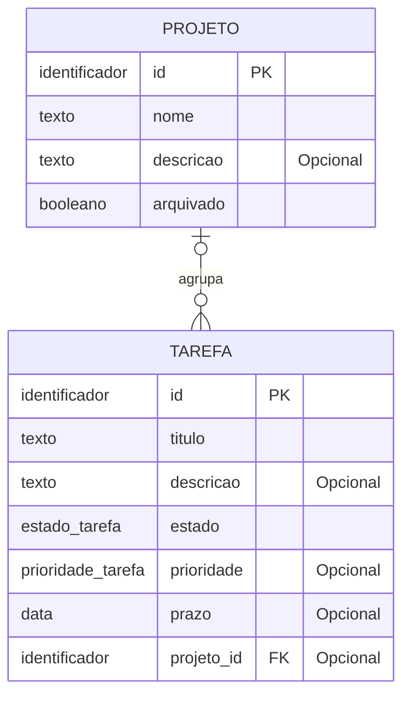

# Ficha Prática 02 — Registo de interações com IA

- **Data de início:** 18/11/2026.
- **Ferramenta:** Codex, nesta conversa.
- **Objetivo:** produzir o Architecture Pack da Matriz a partir do Specification Pack aprovado.
- **Estado:** Exercícios 1 e 2 documentados e aprovados pelo utilizador em 18/11/2026. Renderização Mermaid concluída; contrato API simplificado documentado e validado automaticamente, para revisão humana. Wireframe de baixa fidelidade aprovado pelo utilizador; revisão crítica realizada; P01/P02/P03 e matriz de cobertura aprovadas e aplicadas. Decisões técnicas e riscos de implementação continuam pendentes.

O utilizador informou que fez push do commit da ficha 1. Não foi consultado o remoto nem executado push nesta atividade.

## Exercício 1 — Definição da arquitetura

### 1. Pedido do utilizador

Criar este registo em docs/ai-logs e documentar o progresso da ficha 2, seguindo o método da ficha 1. O prompt arquitetural utilizado foi:

```markdown
# Goal

Definir a arquitetura inicial do MVP da plataforma Matriz, selecionando a abordagem arquitetural mais adequada e justificando tecnicamente a decisão.

# Context

A Matriz encontra-se na fase inicial de desenvolvimento de um MVP (Minimum Viable Product). Nesta fase, é importante privilegiar simplicidade, rapidez de desenvolvimento, facilidade de manutenção e baixo custo operacional, sem comprometer a possibilidade de evolução futura da solução.

Existem três alternativas arquiteturais a considerar:

- Monólito
- Monólito Modular
- Microservices

A decisão deverá ter em conta os requisitos típicos de um MVP, nomeadamente uma equipa reduzida, necessidade de entrega rápida, baixo nível de complexidade inicial e potencial crescimento futuro.

# Constraints

- A comparação entre as alternativas deve ser breve e objetiva.
- Considerar apenas o contexto de um MVP.
- Avaliar cada alternativa com base em:
  - Complexidade de implementação
  - Velocidade de desenvolvimento
  - Facilidade de manutenção
  - Escalabilidade futura
  - Custos operacionais
- Selecionar apenas uma alternativa final.
- Identificar os principais componentes da arquitetura escolhida e as respetivas responsabilidades.
- Produzir conteúdo adequado para ser registado diretamente em docs/architecture.md.

# Task

1. Comparar sucintamente monólito, monólito modular e microservices no contexto do MVP da Matriz.
2. Recomendar a arquitetura mais adequada.
3. Justificar a decisão com base nos critérios definidos.
4. Descrever os principais componentes da solução arquitetural escolhida, incluindo as suas responsabilidades.
5. Gerar o conteúdo final para o ficheiro docs/architecture.md, utilizando uma estrutura clara e objetiva.

# Validation

A resposta será considerada válida apenas se:

- Apresentar uma comparação dos três estilos arquiteturais.
- Selecionar explicitamente uma arquitetura recomendada.
- Fornecer uma justificação técnica coerente com o contexto de um MVP.
- Identificar os principais componentes e respetivas responsabilidades.
- Incluir uma secção de decisão arquitetural clara.
- Produzir conteúdo pronto a ser utilizado em docs/architecture.md.
- Manter a proposta simples, prática e consistente com os objetivos de um MVP.
```

### 2. Contexto efetivamente consultado

- AGENTS.md: instruções de processo e validação.
- docs/requirements.md: F01–F11, regras e exclusões.
- docs/constraints.md: prazo, ausência de login/sincronização e decisões técnicas pendentes.
- docs/user-stories.md: âmbito e regras transversais aprovadas, incluindo arquivo e falhas de gravação.
- Estado Git local: sem alterações antes desta atividade.

As respostas da Parte A da ficha 1 não são uma escolha de stack. O âmbito individual aprovado prevalece sobre os exemplos colaborativos do material pedagógico.

### 3. Resposta produzida

A recomendação única é **monólito modular**, com Projetos e Tarefas como módulos de negócio e componentes comuns para interface, entrada/coordenação de casos de uso, consultas/progresso, persistência e arranque.

O conteúdo integral produzido nesta interação está transcrito abaixo e guardado também em [architecture.md](../architecture.md). Esta transcrição preserva a proposta inicial; futuras aprovações e alterações serão acrescentadas ao registo, sem transformar retroativamente a proposta em decisão já aprovada.

<details>
<summary>Resposta integral — arquitetura proposta</summary>

# Matriz — Arquitetura inicial do MVP

**Data:** 18/11/2026. **Decisão ARQ-01:** monólito modular.
**Estado:** proposta técnica recomendada, pronta para revisão do utilizador. A criação deste documento não constitui aprovação da arquitetura nem implementação.

## Contexto e critérios

A Matriz é uma aplicação de organização individual de projetos e tarefas, sem login ou colaboração no MVP. O âmbito aprovado inclui tarefas independentes ou associadas, lista/Kanban/calendário, pesquisa e filtros, progresso, arquivo/restauro e conservação dos dados entre utilizações.

A entrega final é em 19/11/2026 às 17h, hora de Lisboa, incluindo execução reproduzível, verificações, documentação e demonstração. Não há necessidade confirmada de escalar componentes independentemente ou distribuir o trabalho por equipas autónomas. Equipa reduzida e baixo custo operacional são premissas de desenho fornecidas para esta análise, não medições da utilização futura.

Critérios: complexidade de implementação, velocidade de desenvolvimento, manutenção, escalabilidade futura e custos operacionais. A comparação é qualitativa e relativa a este MVP; não constitui orçamento ou garantia de desempenho.

## Comparação das alternativas

Nesta comparação, monólito significa uma aplicação única organizada principalmente por camadas técnicas; monólito modular mantém a unidade de entrega, acrescentando fronteiras explícitas por responsabilidade de negócio. Um monólito pode ser bem organizado; o acoplamento não é uma consequência obrigatória do estilo.

| Critério | Monólito | Monólito modular | Microservices |
|---|---|---|---|
| Implementação | Baixa complexidade inicial; comunicação interna direta. | Baixa a moderada: exige definir poucos módulos e controlar dependências. | Elevada: comunicação em rede, vários serviços e coordenação de falhas e dados. |
| Velocidade | Arranque rápido; alterações podem atravessar várias camadas à medida que cresce. | Arranque rápido com pequeno esforço de organização; alterações ficam mais localizadas. | Menor adequação ao prazo: configuração, integração e entrega de vários serviços. |
| Manutenção | Simples no início; exige disciplina para evitar dependências dispersas. | Responsabilidades e interfaces explícitas facilitam localizar regras e testar alterações. | Mais componentes e contratos a manter; complexidade operacional desproporcionada neste contexto. |
| Escalabilidade futura | Escala-se a aplicação como um todo; separação posterior depende das fronteiras existentes. | Também escala como um todo; módulos claros facilitam reorganização ou eventual extração justificada. | Permite escalar serviços individualmente, mediante desenho e operação adicionais. |
| Custos operacionais | Tendencialmente baixos: uma unidade de aplicação para operar. | Tendencialmente baixos: uma unidade de aplicação, sem serviços distribuídos por módulo. | Tendencialmente superiores em esforço e infraestrutura para este MVP; sem valores monetários estimados. |

## Decisão arquitetural

**Recomenda-se selecionar exclusivamente um monólito modular para o MVP da Matriz.**

A lógica da aplicação será organizada em poucos módulos dentro da mesma aplicação e entregue como uma unidade. Os módulos comunicam por chamadas internas com contratos explícitos, não por serviços de rede independentes. A persistência é comum à aplicação, respeitando a responsabilidade de cada módulo sobre os seus dados.

A interface é um componente da solução e não constitui um microservice. O eventual uso de uma API HTTP entre interface e aplicação não transforma os módulos internos em serviços distribuídos.

### Justificação

- **Complexidade e velocidade:** conserva uma unidade de entrega e evita descoberta de serviços, brokers e coordenação distribuída, mantendo o trabalho compatível com uma equipa reduzida e prazo curto.
- **Manutenção:** separa projetos e tarefas, com regras identificáveis para arquivo, estados e associação. Lista, Kanban e calendário reutilizam a mesma lógica.
- **Evolução:** permite acrescentar requisitos aprovados dentro de fronteiras claras. Uma futura extração de serviços exigirá necessidade demonstrada e nova decisão; não é automática nem necessária para o MVP.
- **Operação:** reduz o número de componentes que precisam de arranque, configuração e diagnóstico. O custo concreto dependerá da stack e da distribuição ainda por escolher.

Não se seleciona o monólito organizado apenas por camadas porque há regras transversais suficientes para beneficiar de fronteiras explícitas de negócio. Não se selecionam microservices porque não há requisito aprovado que compense os seus custos adicionais no prazo disponível.

## Componentes e responsabilidades

| Componente | Responsabilidades | Limites |
|---|---|---|
| Interface de utilização | Formulários de projetos/tarefas; lista, Kanban e calendário; pesquisa/filtros; confirmação de eliminação e apresentação de erros. | Não mantém três cópias independentes das tarefas nem é a única responsável pelas regras de negócio. |
| Entrada e coordenação dos casos de uso | Receber pedidos, validar estrutura das entradas, coordenar chamadas aos módulos e devolver resultados/erros consistentes. Pode ser exposta por API HTTP, a detalhar no contrato OpenAPI. | Não concentra regras de negócio em controladores ou manipuladores de interface. Não escolhe ainda framework ou endpoints. |
| Módulo Projetos | Criar, consultar e editar projetos; gerir arquivo/restauro; validar nomes; fornecer consulta do estado de arquivo. Responsável pelos dados dos projetos. | Não altera diretamente dados internos de tarefas. Não inclui estados próprios de projeto, eliminação de projetos ou equipas. |
| Módulo Tarefas | Criar, consultar, editar e eliminar tarefas; estados e reabertura; prioridades/prazos; associações opcionais; pesquisa e filtros. Responsável pelos dados das tarefas. | Verifica projeto de origem e destino quando aplicável, por contrato de Projetos. Impede alterações a tarefas de projetos arquivados. |
| Consultas e cálculo de progresso | Combinar consultas dos módulos e calcular concluídas/total, arredondamento e caso sem tarefas; fornecer dados coerentes às visualizações. | É um componente interno de consulta, não um novo serviço ou módulo com cópia própria dos dados. Não guarda percentagem como segunda fonte de verdade. |
| Persistência e tratamento de gravação | Implementar acesso aos dados, integridade e operações atómicas quando necessário; confirmar sucesso só depois de gravar; conservar dados confirmados perante falhas. | Tecnologia e modelo físico pendentes. Os módulos usam interfaces de acesso, sem manipular diretamente a persistência de outros módulos. |
| Configuração e arranque | Preparar execução reproduzível, dependências e configuração documentadas para o mesmo ambiente e outro computador. | Sem autenticação ou publicação pública implícitas; não acrescenta sincronização. |

Projetos e Tarefas são os dois módulos de negócio propostos. Os restantes componentes são responsabilidades internas ou transversais; não exigem projetos separados, frameworks próprios ou uma biblioteca por camada.

## Fronteiras, dados e consistência

- A tarefa tem associação opcional a projeto. Não se introduzem entidades Utilizador, Equipa, Comentário ou Atribuição múltipla sem um requisito aprovado.
- Tarefas consulta o estado de arquivo através do contrato de Projetos antes de editar, concluir/reabrir, eliminar, transferir ou desassociar uma tarefa e antes de a associar a um projeto de destino.
- Projetos pode ser arquivado sem reescrever os estados das tarefas. As consultas principais excluem projetos arquivados e as suas tarefas; a consulta de arquivo permite localizar/restaurar projetos.
- O coordenador de consultas usa contratos internos de leitura de Projetos e Tarefas; Projetos não precisa de depender de Tarefas para calcular progresso. Evitar dependência circular entre módulos.
- O progresso é derivado das tarefas confirmadas de cada projeto. Alterar estado, eliminar ou transferir uma tarefa muda o resultado das consultas seguintes, sem contador duplicado para manter sincronizado.
- Lista, Kanban e calendário usam a mesma origem de dados e a mesma regra de interseção de pesquisa/filtros. O calendário acrescenta a condição de existir prazo no período consultado.
- Não declarar sucesso antes da confirmação da gravação. Em falha, apresentar erro e manter os últimos dados confirmados; operações que afetem várias alterações persistidas devem ser atómicas.
- O desenho da persistência deve impedir associações a projetos inexistentes e respeitar o arquivo. Os mecanismos concretos serão definidos no modelo de dados e implementação.

## Fluxos de referência

1. **Criar tarefa:** interface → entrada/caso de uso → Tarefas → consulta de Projetos se houver associação → validação → gravação confirmada → atualização das consultas.
2. **Arquivar projeto:** interface → caso de uso de Projetos → gravação do arquivo → consultas principais deixam de incluir projeto/tarefas. Os dados das tarefas conservam-se.
3. **Consultar progresso:** interface → consulta coordenada → leitura das tarefas do projeto → cálculo segundo DEC-05/PV-03 → resultado; zero tarefas produz 0% e Sem tarefas.

## Limitações, riscos e evolução

- Há uma unidade de entrega: uma alteração implica voltar a entregar a aplicação; não existe escalabilidade independente por módulo.
- A modularidade depende de disciplina e revisão: organizar pastas, por si só, não impede acoplamento.
- Regras de arquivo e associação precisam de testes para não serem contornadas por um ponto de entrada diferente.
- O MVP sem login destina-se a ambiente de confiança e não garante isolamento de dados. Não está aprovada exposição pública em rede.
- A seleção de tecnologias deve manter a estrutura pequena; não acrescentar mensageria, CQRS, serviços autónomos ou camadas repetitivas sem necessidade concreta.

## Decisões ainda pendentes

| Tema | Próxima atividade |
|---|---|
| Linguagem, framework e tecnologias de interface | Comparar uma stack pequena e compatível com execução reproduzível e prazo; submeter a escolha para validação. |
| Persistência, identificadores e modelo físico | Exercício 2: entidades, relações, integridade e ER em docs/database.md; selecionar tecnologia separadamente. |
| Contrato de entrada HTTP | Exercício 3: especificar pelo menos duas operações REST em OpenAPI 3.1; ainda não implementadas. |
| Protótipo | Exercício 4: wireframe de um ecrã relevante e revisão contra o MVP. |
| Arranque e distribuição | Definir e verificar comandos e pré-requisitos; atualizar README após implementação. |

## Verificação documental e fontes

A proposta mantém F01–F11, tarefas independentes, arquivo restritivo, três vistas, progresso e persistência. Não introduz funcionalidades de colaboração nem escolhe tecnologias. A verificação é documental: não foram compilados componentes ou executados testes de aplicação.

- [Requisitos aprovados](../requirements.md)
- [User Stories e critérios](../user-stories.md)
- [Restrições e pendências](../constraints.md)
- [Instruções para agentes](../../AGENTS.md)
- [Registo da ficha 2](ficha-02.md)

</details>

### 4. Revisão crítica da proposta

| Critério do pedido | Resultado |
|---|---|
| Comparar os três estilos nos cinco critérios | Tabela qualitativa com implementação, velocidade, manutenção, escala e custos. |
| Selecionar uma alternativa | Monólito modular, identificado como ARQ-01 proposta. |
| Fundamentar no MVP real | Uso individual, prazo curto, ausência de escala independente exigida e baixo esforço operacional. |
| Componentes e responsabilidades | Dois módulos de negócio; componentes de suporte sem serviços distribuídos por módulo. |
| Respeitar requisitos | Preserva tarefas opcionais por projeto, regras de arquivo, vistas consistentes, progresso e falhas. |
| Separar decisões de pressupostos | Equipa reduzida é premissa de desenho; stack e persistência permanecem pendentes. |
| Validação executada | Leitura e consistência documental; referências locais verificadas. Não existe implementação a testar. |

A modularidade proposta não garante extração futura simples: será necessário preservar contratos e evitar acesso direto aos dados de outros módulos. O risco mais imediato é excesso de estrutura face ao prazo; por isso, a proposta limita-se a dois módulos de negócio, sem tecnologias ou dependências novas.

### 5. Intervenção humana

**Aprovada em 18/11/2026:** o utilizador respondeu “sim aprovo” à proposta ARQ-01 — monólito modular e respetiva distribuição de responsabilidades. A transcrição acima preserva a resposta inicial; o estado atual da decisão é aprovado.

### 6. Próximos exercícios

1. ARQ-01 validada: monólito modular aprovado.
2. Modelar entidades, atributos e relações e gerar ER Mermaid em docs/database.md.
3. Documentar pelo menos duas operações REST em openapi.yaml, OpenAPI 3.1.
4. Produzir um wireframe em docs/ui/ ou referência equivalente.
5. Rever consistência entre requisitos, arquitetura, dados, API e interface.

Nenhum modelo de dados, contrato ou wireframe foi dado como concluído nesta atividade.

### 7. Registo de aprovação — ARQ-01

**Data:** 18/11/2026. **Decisão humana:** “sim aprovo”.

Aprovados o monólito modular, os módulos Projetos e Tarefas e os componentes internos de suporte descritos em [architecture.md](../architecture.md). Tecnologias, persistência, modelo de dados e contratos de API permanecem por definir. O README e o estado da arquitetura foram atualizados.

**Próximo passo:** Exercício 2 — propor o modelo de dados e o diagrama ER, respeitando tarefas independentes e o âmbito individual sem contas de utilizador.

## Exercício 2 — Modelação de dados e diagrama ER

**Data:** 18/11/2026. **Ferramenta:** Codex, nesta conversa.

### Pedido e contexto

O utilizador pediu um ERD Mermaid baseado exclusivamente num modelo previamente aprovado, com entidades, atributos, PK/FK, cardinalidades e integridade, sem SQL/migrations nem alterações de ficheiros antes de autorização.

A premissa inicial de existir modelo validado foi corrigida: só havia requisitos e um resumo informal. Foi apresentada uma tabela conceptual de PROJETO e TAREFA, atributos e relação opcional 1:N. O utilizador respondeu “sim”, aprovando o modelo.

### Resposta produzida e aprovação

Foi apresentado o seguinte diagrama para revisão:



Foram explicadas as chaves PROJETO.id, TAREFA.id e a referência opcional TAREFA.projeto_id; a cardinalidade permite projetos sem tarefas e tarefas independentes. Não existem relações N:M. O progresso é derivado e as restrições de arquivo não são integralmente expressas pelo ERD. A renderização foi explicitamente assinalada como não executada.

O utilizador respondeu **“aprovo vamos avançar”**, aprovando o diagrama e autorizando continuar o registo documental. Decisão **DADOS-01 aprovada**.

### Artefacto e verificação

Criado [database.md](../database.md), com modelo aprovado, diagrama, cardinalidades, chaves, integridade, dados derivados, rastreabilidade e limitações. Atualizadas referências no README, architecture.md e pendências em constraints.md. A transcrição deste registo preserva as aprovações e não antecipa decisões físicas.

Verificação documental: apenas PROJETO e TAREFA; associação opcional; tipos conceptuais; sem Utilizador/Equipa/Comentário nem entidades associativas; sem SQL/migrations. Referências locais verificadas. **Renderização Mermaid permanece pendente**, assim como tipos físicos, tecnologia e valor inicial de arquivado.

**Próximo passo:** Exercício 3 — selecionar e documentar pelo menos duas operações REST num contrato OpenAPI 3.1, consistente com os modelos e regras aprovados.

### Validação de renderização do ERD — 18/11/2026

**Pedido:** o utilizador solicitou executar a renderização que permanecia pendente.

- Fonte extraída do bloco aprovado de database.md, sem alterar entidades, atributos ou cardinalidades, para [matriz-erd.mmd](../diagrams/matriz-erd.mmd).
- Mermaid CLI 12.2.0 executado com Chrome headless; gerados [SVG](../diagrams/matriz-erd.svg) e [PNG](../diagrams/matriz-erd.png).
- Ambos os comandos terminaram com código 0. A imagem PNG foi aberta e inspecionada: duas entidades, todos os atributos, PK/FK, comentários opcionais e marcadores de cardinalidade legíveis, sem cortes.
- Atualizados database.md, README e constraints.md. Corrigida a descrição textual da chave própria da tarefa, sem alterar o código do diagrama aprovado.
- A primeira descarga do CLI falhou por DNS no ambiente restrito; a repetição autorizada com rede permitiu executar o renderizador. A ferramenta foi usada para documentação, sem acrescentar dependências à aplicação.

**Estado atual:** renderização validada. As menções anteriores a pendente neste histórico descrevem o estado antes desta execução. Não foram gerados SQL ou migrations.

## Exercício 3 — API Design com OpenAPI

**Data:** 18/11/2026. **Ferramenta:** Codex. **Estado:** contrato simplificado produzido e validado, para revisão humana; sem código de API implementado.

### 1. Pedido e delimitação do âmbito

O primeiro pedido originou uma proposta extensa com nove operações. O utilizador reformulou o pedido para selecionar **apenas duas operações REST**, gerar OpenAPI 3.1 simplificado, definir DTOs, parâmetros e status codes e usar exclusivamente o âmbito aprovado. A proposta anterior de nove operações não foi aprovada e não é o contrato atual.

Documentos consultados: requirements.md, user-stories.md, constraints.md, database.md, architecture.md e AGENTS.md. Todos estavam disponíveis.

### 2. Clarificações e decisão humana

Antes de gerar o contrato foram identificadas duas definições pendentes: valor inicial de arquivo de projetos e representação dos identificadores na API. O utilizador respondeu **“sim”** às propostas:

- Projetos criados com arquivado=false, sem pedir esse campo ao utilizador.
- Identificadores JSON como strings opacas. Não impõe UUID ou texto na persistência.

Decisão **API-01-A aprovada**, registada também no modelo de dados. As restantes convenções técnicas do contrato gerado são a proposta disponível para revisão, não decisões retroativamente atribuídas ao utilizador.

### 3. Operações selecionadas e contratos

| Operação | Objetivo | Origem | Parâmetros | Request DTO | Response DTO | Status codes |
|---|---|---|---|---|---|---|
| POST /projetos | Criar projeto com nome e descrição opcional, inicialmente não arquivado. | F01; US-01 | Sem path ou query; corpo JSON obrigatório. | CriarProjetoRequest | ProjetoResponse | 201; 400; 422; 500 |
| POST /tarefas | Criar tarefa independente ou de projeto existente não arquivado. | F02, F06; US-03 | Sem path ou query; corpo JSON obrigatório. | CriarTarefaRequest | TarefaResponse | 201; 400; 404; 409; 422; 500 |

**Convenções propostas de contrato:** recursos em português, campos JSON camelCase, campos opcionais admitindo null, DTOs separados dos objetos persistidos, rejeição de propriedades desconhecidas, erros em application/problem+json com codigo e erros por campo. As respostas incluem os campos opcionais, usando null quando ausentes. O cabeçalho Location identifica o recurso criado; esta especificação não implementa nem documenta uma operação GET para esse endereço.

**Regras de negócio preservadas:** nome e título obrigatórios e não compostos apenas por espaços; estado inicial Por Fazer; quatro estados e quatro prioridades aprovados; prazo opcional com datas passadas permitidas; projetoId opcional; projeto associado existente e não arquivado. Não devolver sucesso antes de confirmar a gravação.

**Erros:** 400 para JSON malformado; 422 para dados do corpo inválidos; 404 para projeto referenciado inexistente; 409 para associação a projeto arquivado; 500 para falha interna/de gravação, preservando dados confirmados e sem expor detalhes internos.

**Autenticação/autorização:** security=[] por decisão aprovada de MVP sem login; não inventar utilizadores, ownership ou permissões por perfil. A restrição de arquivo é validada no backend. Exposição pública continua não aprovada.

**Paginação, pesquisa, filtros e ordenação:** não se aplicam às duas operações de criação. Permanecem requisitos do MVP, mas não se acrescentam operações de consulta a este contrato simplificado. A especificação não pretende cobrir todas as User Stories.

### 4. Artefacto e validação executada

Criado [openapi.yaml](../../openapi.yaml), OpenAPI 3.1.0, com apenas POST /projetos e POST /tarefas, Request/Response DTOs, erros e exemplos. Não foram criadas entidades, SQL, migrations ou implementação da API.

Verificações executadas com openapi-spec-validator 0.9.0 e jsonschema 4.26.0, instalados numa pasta temporária ignorada pelo Git, sem alterar dependências da aplicação:

- Documento OpenAPI 3.1 validado sem erros.
- Confirmada a existência de exatamente duas operações POST.
- Dez exemplos de pedidos/respostas/erros validados contra os schemas correspondentes.
- Pedidos mínimos com nome/título aceites pelos schemas.
- Ausência do campo obrigatório, texto apenas com espaços e propriedades desconhecidas rejeitados.
- Tarefa sem projeto e sem prioridade aceite.
- Prazo passado aceite; data impossível e estado inexistente rejeitados.

Estes resultados validam a especificação e os schemas, não provam persistência, existência de referências ou bloqueio de arquivo numa API em execução. Essas regras exigem testes de implementação.

### 5. Ambiguidades existentes e riscos

Continuam pendentes o tipo físico dos identificadores, limites de texto, tecnologia de persistência e ambiente de execução. Valor inicial de arquivado e formato dos identificadores JSON ficaram resolvidos nesta interação. As outras pendências dos documentos, como pesquisa por acentos e ordenação das consultas, não afetam estas operações de criação.

Os DTOs não obrigam a reutilizar entidades de persistência. Um timeout de comunicação pode deixar o cliente sem conhecer o resultado de uma criação; não repetir automaticamente POST sem avaliar o risco de duplicação. Não se acrescentou idempotência ou recuperação automática como funcionalidade aprovada.

### 6. Próximo passo

Rever o contrato simplificado e, depois, avançar para o Exercício 4: wireframe de um ecrã do MVP. A revisão final do Architecture Pack verificará consistência entre requisitos, dados, arquitetura, API e interface.

## Exercício 4 — Prototipagem de interface

**Data:** 18/11/2026. **Ferramenta:** Codex; imagem gerada por desenho programático monocromático, sem selecionar tecnologias da aplicação. **Estado:** proposta de layout para revisão humana.

### 1. Pedido e contexto

O utilizador pediu selecionar um ecrã relevante, organizar navegação/conteúdo/ações, criar um wireframe low-fidelity, explicar as secções e mapear as áreas às funcionalidades e histórias, guardando o artefacto em docs/ui/. Foram consultados os seis documentos indicados: requirements.md, user-stories.md, constraints.md, database.md, architecture.md e AGENTS.md.

### 2. Ecrã e resposta produzida

Selecionado **Tarefas — lista e detalhe de edição**. A lista é o centro da consulta do trabalho individual e permite representar tarefas independentes, prazos/prioridades opcionais, quatro estados e uma associação a projeto. O painel mostra a tarefa selecionada; o progresso refere-se ao projeto dessa tarefa, calculado sobre todas as tarefas do projeto.

Criados:

- [Wireframe PNG](../ui/wireframe-tarefas.png): um ecrã desktop, sem interação, com seis áreas numeradas.
- [Descrição, legenda e rastreabilidade](../ui/wireframe-tarefas.md): fluxos, campos, estados de suporte, decisões de desenho e limitações.

| Área | Conteúdo | Rastreabilidade |
|---|---|---|
| 1 | Navegação Tarefas, Projetos, Arquivados e Novo projeto. | F01, F09; US-01/02/12 como destinos. |
| 2 | Cabeçalho e Nova tarefa. | F02; US-03. |
| 3 | Lista/Kanban/Calendário, pesquisa e filtros. | F05, F11; US-06/07/08/14. |
| 4 | Lista com tarefas associadas e independentes. | F02, F05, F06; US-04/06. |
| 5 | Painel com título, descrição, projeto, estado, prioridade e prazo; guardar/cancelar/eliminar. | F02, F03, F06, F08, F10; US-04/05/10/13. |
| 6 | Progresso do projeto Curso: 1 concluída em 4, 25,0%. | F07; US-09. |

Os exemplos são fictícios. Há quatro tarefas no projeto Curso e uma independente; a independente não entra no progresso. Não foram introduzidos login, equipas, notificações, comentários, subtarefas, relatórios ou eliminação de projetos.

### 3. Validação e revisão crítica

A imagem PNG foi aberta e inspecionada visualmente: textos legíveis, campos e tabela sem sobreposição, rótulos e tarefa selecionada coerentes entre lista e painel. A imagem usa apenas branco/cinzentos/preto e não define identidade visual final. Referências locais verificadas.

Navegação permite aceder aos fluxos principais descritos, mas só o ecrã de lista/edição foi desenhado. Kanban, calendário, gestão de projetos, arquivo/restauro e confirmação de eliminação são destinos ou variantes descritos, não protótipos adicionais concluídos. Sem teste de usabilidade, acessibilidade, persistência ou API em execução.

O contrato OpenAPI simplificado continua limitado a duas operações de criação. Os controlos de consulta/edição/arquivo/eliminação representam requisitos aprovados do MVP, mas não significam que existam contratos completos ou implementação desses endpoints.

### 4. Decisões e pendências

O painel de edição à direita, a posição dos controlos e o indicador do projeto selecionado são propostas de UX para revisão; não decisões já aprovadas pelo utilizador. Permanecem pendentes adaptação a ecrãs pequenos, detalhe de navegação do calendário, ordenação inicial, limites de texto e comportamento de acentos, conforme a especificação.

**Próximo passo:** rever o wireframe e realizar o Exercício 5 — revisão crítica da consistência do Architecture Pack, distinguindo aprovação de requisitos, propostas de contrato/layout e implementação ainda por fazer.

### Aprovação do Exercício 4 — UI-01

**Data:** 18/11/2026. **Decisão humana:** “aprovado”.

O utilizador aprovou o wireframe Tarefas — lista e detalhe de edição, incluindo disposição da navegação, filtros, lista, painel de edição e progresso do projeto selecionado. Atualizados os estados no documento do wireframe, README e arquitetura. A imagem aprovada não foi alterada.

A aprovação não significa que os destinos não desenhados estejam prototipados, nem que a aplicação esteja implementada. As convenções do contrato OpenAPI não recebem aprovação implícita nesta decisão específica de interface.

**Próximo passo:** Exercício 5 — revisão crítica e Human-in-the-Loop do Architecture Pack.

## Exercício 5 — Revisão crítica e Human-in-the-Loop

**Data:** 18/11/2026. Documentos revistos: requirements.md, user-stories.md, constraints.md, database.md, architecture.md, openapi.yaml, docs/ui/ e AGENTS.md. A revisão inicial foi apenas de leitura, incluindo validação automática OpenAPI e inspeção visual do wireframe.

### Resultado da análise

Identificados 3 problemas confirmados, 5 riscos e 3 sugestões de melhoria. Não se verificaram componentes sem justificação, atributos sem uso ou endpoints fora do âmbito. Todas as histórias têm suporte conceptual; apenas as duas criações têm contrato REST e apenas um ecrã foi desenhado, conforme o âmbito simplificado dos exercícios. A matriz detalhada está em [architecture-review.md](../architecture-review.md).

### Decisão humana

A recomendação final foi começar pelas três correções confirmadas P01, P02, P03 e pelo registo da matriz de cobertura. O utilizador respondeu **“ok aceito a sugestão”**. Essa autorização foi aplicada a essas correções e a S01. Não se interpretou a aceitação como seleção de stack, persistência, distribuição ou soluções de timeout/idempotência.

### Correções aplicadas

- **P01:** relação Mermaid corrigida de identificadora para não identificadora (o|..o{), mantendo entidades, atributos e cardinalidades. Atualizados database.md e fonte .mmd; SVG/PNG regenerados e inspecionados.
- **P02:** exemplo de erro 422 da criação de projetos usa nome; o de tarefas mantém titulo. O schema de erro continua partilhado.
- **P03:** acrescentado CA-US-01-03, verificando arquivado=false após criação. Matriz F01 e contagens no README/requirements atualizadas para 55 critérios.
- **S01:** criada matriz consolidada de cobertura em architecture-review.md com estado dos problemas, riscos e sugestões.

### Verificações após correção

- OpenAPI 3.1 validado automaticamente sem erros; continuam exatamente duas operações POST.
- Onze exemplos de media type validados contra schemas após separar o exemplo de erro de projetos.
- 14 histórias, 55 critérios com identificadores únicos e 13 casos excecionais.
- Fonte Mermaid do documento igual ao .mmd; renderização dos dois formatos terminada com código 0 e PNG inspecionado, com relação tracejada legível.
- Referências locais válidas e git diff --check sem erros. Sem testes de aplicação, porque não existe implementação nesta fase.

### Estado atual e próximos passos

Revisão do Architecture Pack concluída com intervenção humana e correções aprovadas aplicadas. Os riscos e melhorias pendentes permanecem explicitamente registados, sem aprovação implícita de novas soluções técnicas. O contrato simplificado continua uma proposta para revisão do seu conjunto de convenções; só as duas clarificações API-01-A e a correção P02 receberam aprovação explícita nesta sequência.

Próxima fase: escolher e justificar tecnologias/persistência/arranque, preparar a implementação e completar os contratos necessários aos fluxos do MVP. O registo das alterações num commit Git e a publicação não foram executados nesta atividade.
