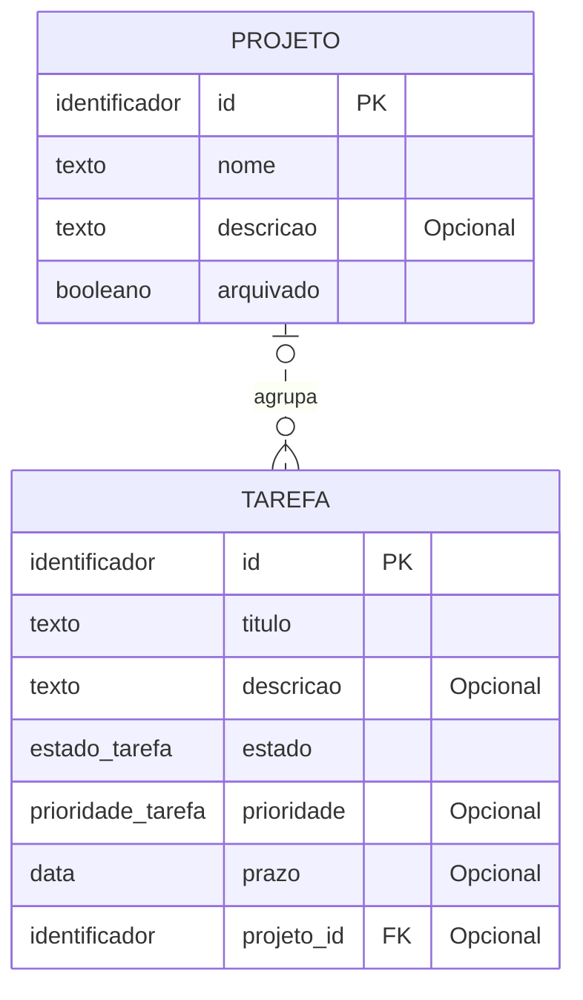
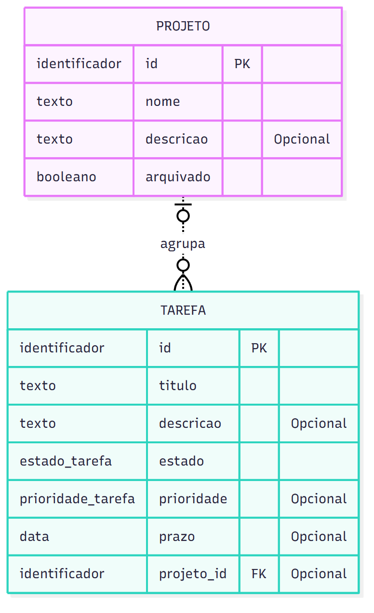

# Matriz — Modelo de dados e diagrama ER

**Data:** 18/11/2026. **Decisão DADOS-01:** modelo conceptual e ERD aprovados pelo utilizador. Sem implementação física.

## Origem e validação humana

O modelo foi proposto com base nos requisitos e arquitetura aprovados. O utilizador aprovou primeiro as entidades, atributos e cardinalidades com “sim” e aprovou depois o diagrama com “aprovo vamos avançar”. Esta aprovação autoriza o registo documental, sem selecionar tecnologia, tipos físicos, SQL ou migrations.

## Entidades e atributos

| Entidade | Atributo | Tipo conceptual | Obrigatoriedade e integridade |
|---|---|---|---|
| PROJETO | id | Identificador | Chave primária, única e obrigatória. |
| PROJETO | nome | Texto | Obrigatório; não vazio nem apenas espaços. |
| PROJETO | descricao | Texto | Opcional. |
| PROJETO | arquivado | Booleano | Indica se o projeto está arquivado; inicialmente false, aprovado na preparação do contrato API-01. |
| TAREFA | id | Identificador | Chave primária, única e obrigatória. |
| TAREFA | titulo | Texto | Obrigatório; não vazio nem apenas espaços. |
| TAREFA | descricao | Texto | Opcional. |
| TAREFA | estado | Enumeração | Obrigatório: Por Fazer, Em Curso, Em Revisão ou Concluída; inicialmente Por Fazer quando não escolhido outro. |
| TAREFA | prioridade | Enumeração | Opcional: Baixa, Média, Alta ou Crítica. |
| TAREFA | prazo | Data | Opcional; admite datas passadas. |
| TAREFA | projeto_id | Referência a PROJETO | Chave estrangeira opcional; quando preenchida, referencia um PROJETO.id existente. |

Os tipos são conceptuais. Identificador não significa automaticamente inteiro ou UUID; Texto não impõe limite de comprimento. Prazo é data de conclusão prevista, não data de conclusão efetiva. A ausência de prioridade é representada como ausência de valor; Sem prioridade é opção de filtro, não um quinto nível.

## Relacionamentos e cardinalidades

| Origem | Destino | Relação e obrigatoriedade |
|---|---|---|
| PROJETO | TAREFA | Um projeto agrupa zero ou várias tarefas. Pode existir sem tarefas. |
| TAREFA | PROJETO | Uma tarefa pertence a zero ou um projeto. A associação é opcional. |

Não existem relações N:M nem entidades associativas. Não se incluem Utilizador, Equipa, Comentário ou Atribuição porque não são necessários ao âmbito individual aprovado.

## Diagrama ER em Mermaid

### Imagem renderizada

[Versão SVG](diagrams/matriz-erd.svg) · [Fonte Mermaid](diagrams/matriz-erd.mmd)

Na relação `PROJETO o|..o{ TAREFA`, o marcador junto a PROJETO representa os zero ou um projetos de cada tarefa, e o marcador junto a TAREFA representa as zero ou várias tarefas de cada projeto. A tarefa possui chave primária própria; projeto_id é uma referência opcional e não integra essa chave. A linha tracejada representa uma relação não identificadora, coerente com a existência independente da tarefa. Correção semântica P01 aprovada na revisão do Architecture Pack, sem alterar cardinalidades ou atributos.

## Chaves e regras de integridade

- PROJETO.id e TAREFA.id identificam registos únicos das respetivas entidades.
- TAREFA.projeto_id é opcional; não pode referenciar um projeto inexistente.
- Associar, transferir e desassociar uma tarefa mantém o identificador e os restantes atributos da tarefa.
- Transições entre estados são livres, incluindo reabertura.
- Projetos não são eliminados no MVP: não é necessária uma funcionalidade de eliminação em cascata. A estratégia física de integridade referencial será definida posteriormente, respeitando esta exclusão.
- Arquivo conserva projeto, tarefas, estados e associações. Não equivale a eliminação.
- Durante o arquivo, impedir novas associações ao projeto e edição, mudança de estado, eliminação, transferência e desassociação das suas tarefas. As consultas principais excluem-nas; o restauro repõe a elegibilidade respeitando filtros e prazo.
- Em falha de gravação, manter os últimos dados confirmados e não anunciar sucesso. Os mecanismos de gravação atómica pertencem ao desenho físico e implementação.

As restrições de arquivo e transições são regras de negócio. O diagrama e uma chave estrangeira, isoladamente, não garantem o seu cumprimento.

## Dados derivados e consultas

O progresso não é atributo persistido: tarefas concluídas do projeto ÷ total de tarefas do projeto × 100, arredondado a uma casa decimal. Sem tarefas, mostrar 0% e Sem tarefas. Tarefas independentes não contam para projetos. Concluir, reabrir, transferir ou eliminar uma tarefa altera as consultas seguintes do progresso.

Lista, Kanban e calendário são representações dos mesmos dados, não entidades nem cópias independentes. O calendário usa prazo quando preenchido; tarefas sem prazo permanecem elegíveis para lista/Kanban. Pesquisa e filtros usam título, projeto, estado e prioridade, com as regras de visibilidade aprovadas.

## Rastreabilidade

| Elemento do modelo | Requisitos e histórias |
|---|---|
| PROJETO, nome e descricao | F01; US-01 e US-02 |
| PROJETO.arquivado e conservação das associações | F09; US-12 |
| TAREFA, titulo e descricao | F02; US-03 e US-04 |
| TAREFA.estado | F03; US-05; agrupamento de US-07 |
| TAREFA.prioridade e prazo | F06; US-04 e US-08 |
| TAREFA.projeto_id opcional | F08; US-10; tarefas independentes de US-03 |
| Progresso derivado | F07; US-09 |
| Conservação/eliminação de registos | F04 e F10; US-11 e US-13 |
| Consultas e representações | F05 e F11; US-06–08 e US-14 |

## Pendências e limitações

- Selecionar tecnologia e mecanismo de persistência, tipos físicos de identificador, limites de texto e detalhes de constraints/índices na fase adequada.
- Valor inicial de arquivado resolvido: false na criação, aprovado pelo utilizador na preparação do contrato API-01. Os identificadores na API são strings opacas; isto não define o tipo físico de persistência.
- Rever proteção, recuperação e ambiente de execução nos termos de constraints.md.
- Validação conceptual executada: duas entidades, relação 1:N opcional nas duas pontas e referência coerente. Não foram introduzidas entidades não aprovadas.
- Renderização executada com Mermaid CLI 12.2.0, usando Chrome em modo headless. SVG e PNG gerados sem erros a partir da fonte Mermaid aprovada e inspecionados visualmente: entidades, atributos, chaves e cardinalidades legíveis, sem cortes. Validação de renderização concluída em 18/11/2026.
- Sem SQL, migrations ou base de dados implementada.

## Referências

- [Requisitos](requirements.md)
- [User Stories](user-stories.md)
- [Restrições](constraints.md)
- [Arquitetura aprovada](architecture.md)
- [Registo e aprovação da ficha 2](ai-logs/ficha-02.md)
