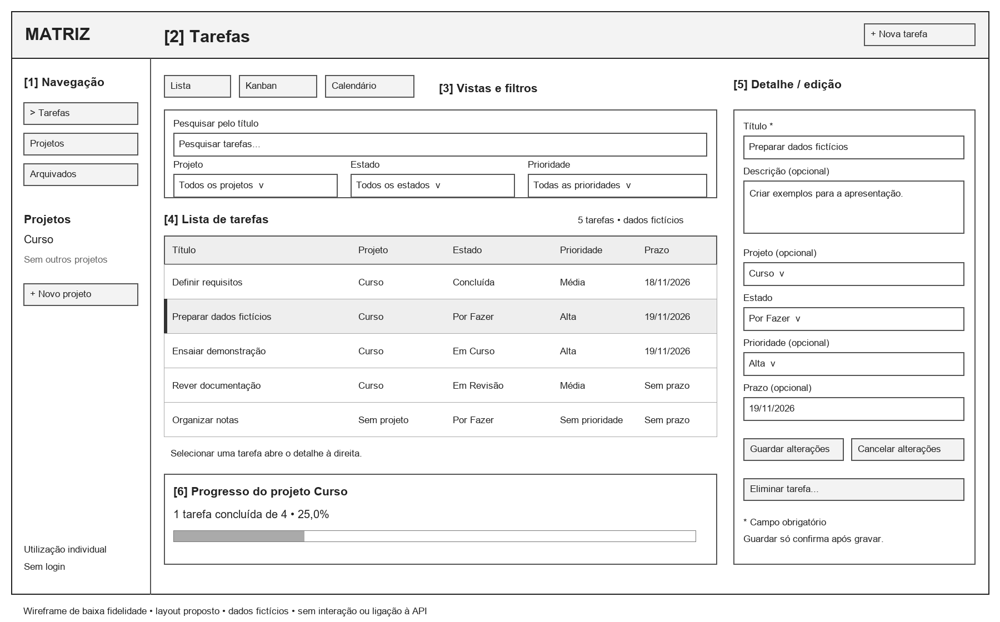

# Matriz — Wireframe de tarefas

**Data:** 18/11/2026. **Estado:** wireframe aprovado pelo utilizador em 18/11/2026, mediante resposta “aprovado”. Sem aplicação ou API implementada.

## Ecrã selecionado

**Nome:** Tarefas — lista e detalhe de edição.

**Objetivo:** consultar e organizar tarefas, selecionar uma tarefa para edição, mudar de visualização e aceder à gestão de projetos. É o ecrã central do trabalho individual, sem introduzir um dashboard de métricas adicionais.

**Histórias diretamente representadas:** US-03, US-04, US-05, US-06, US-09, US-10, US-13 e US-14. A navegação dá acesso aos destinos de US-01/02, US-07/08 e US-12, cujos ecrãs não foram desenhados nesta atividade. US-11 é um comportamento transversal de persistência, não demonstrado pela imagem.

## Wireframe visual

A imagem é monocromática, com caixas, rótulos, tabela e campos. Os cinzentos indicam apenas separação e seleção, sem definir identidade visual ou cores finais. Os dados são fictícios; o projeto Curso tem quatro tarefas e uma concluída, logo 25,0%. A quinta tarefa é independente e não entra no progresso.

## Estrutura e legenda

| Área | Elementos | Propósito |
|---|---|---|
| 1 — Navegação | Tarefas, Projetos, Arquivados e Novo projeto. | Aceder ao trabalho ativo, gerir projetos e localizar/restaurar os arquivados. |
| 2 — Cabeçalho | Nome do ecrã e Nova tarefa. | Identificar o contexto e permitir registar trabalho sem exigir um projeto. |
| 3 — Vistas e filtros | Lista, Kanban, Calendário, pesquisa pelo título e filtros por projeto, estado e prioridade. | Reutilizar os mesmos dados e combinar critérios por interseção. |
| 4 — Lista | Título, projeto, estado, prioridade e prazo; uma linha selecionada. | Consultar tarefas associadas e independentes, incluindo tarefas sem prazo ou prioridade. |
| 5 — Detalhe/edição | Título, descrição, projeto, estado, prioridade e prazo; Guardar, Cancelar e Eliminar. | Consultar/alterar dados, associação e estado, respeitando a confirmação de eliminação. |
| 6 — Progresso | Contagem e percentagem do projeto da tarefa selecionada. | Acompanhar o cálculo aprovado, sem métricas inventadas ou estados próprios do projeto. |

## Navegação e fluxos propostos

1. **Criar projeto e tarefa:** Novo projeto abre o formulário de nome/descrição; após gravação, Nova tarefa abre os campos do painel em modo de criação. Projeto é opcional. Esses formulários são destinos/variantes descritos, não ecrãs adicionais desenhados.
2. **Editar tarefa:** selecionar linha abre o detalhe; Guardar envia as alterações e só anuncia sucesso após confirmação. Cancelar não guarda a edição. Estado permite as quatro opções e reabertura; Projeto permite mudar associação ou escolher Sem projeto.
3. **Consultar vistas:** Lista, Kanban e Calendário representam o mesmo conjunto com as mesmas regras de pesquisa/filtros. O calendário só representa tarefas com prazo. A imagem desenha apenas Lista; não simula que os outros ecrãs foram prototipados.
4. **Eliminar:** Eliminar tarefa abre confirmação com aviso de eliminação definitiva. Confirmar executa a operação; cancelar mantém os dados e não envia pedido de eliminação. A confirmação está especificada, mas não desenhada na imagem.
5. **Gerir arquivo:** Arquivados abre consulta separada com restauro. Projetos permite consultar/editar/arquivar. Tarefas arquivadas não aparecem nesta lista e não podem ser editadas, transferidas, desassociadas ou eliminadas antes do restauro.

## Campos e comportamento

- Título obrigatório; nome é obrigatório no formulário de projeto. Texto só com espaços é inválido.
- Descrição opcional. Prazo opcional, com datas passadas permitidas.
- Estado: Por Fazer, Em Curso, Em Revisão e Concluída. Na criação, usar Por Fazer se não escolhido outro.
- Prioridade opcional: Baixa, Média, Alta, Crítica; permitir retirar o valor.
- Projeto opcional: projetos não arquivados e Sem projeto. Não apresentar projetos arquivados como destinos de associação.
- Filtro Projeto contém Todos os projetos e Sem projeto, além dos projetos disponíveis; Prioridade contém Todas as prioridades e Sem prioridade. Todos significa ausência daquele filtro, não uma nova regra de negócio.
- A progressão mostrada refere-se ao projeto da tarefa selecionada, contando todas as suas tarefas, independentemente dos filtros da lista. Não apresentar progresso de projeto quando a seleção for uma tarefa independente. Projeto sem tarefas mostra 0% e Sem tarefas no destino de projetos.
- A tarefa selecionada tem estado Por Fazer, prioridade Alta e prazo 19/11/2026, coerentes entre lista e painel. Nenhuma tarefa de projeto arquivado está presente.

## Estados de suporte previstos, não desenhados

- **Sem resultados:** indicação Sem tarefas correspondentes, conservando pesquisa/filtros visíveis para ajuste.
- **Validação:** mensagem junto do campo inválido, impedindo a gravação.
- **Gravação em curso:** não anunciar sucesso antes da confirmação.
- **Falha de gravação:** mensagem explícita; conservar últimos dados confirmados e permitir nova tentativa após corrigir a causa.
- **Sem seleção:** painel de detalhe não apresenta dados de uma tarefa fictícia como se estivesse selecionada.

A localização das mensagens e do formulário é uma proposta de desenho, não um novo requisito funcional.

## Rastreabilidade

| Área/fluxo | Funcionalidade | User Stories | Evidência e limite |
|---|---|---|---|
| Navegação Projetos / Novo projeto | F01 | US-01, US-02 | Acesso representado; formulário de projeto não desenhado. |
| Cabeçalho Nova tarefa / painel | F02, F06 | US-03, US-04 | Campos aprovados e ação de criação; variante de criação descrita. |
| Estado no painel e na lista | F03 | US-05 | Quatro estados e reabertura descritos; sem exigir arrastar cartões. |
| Lista | F05 | US-06 | Tarefas associadas/independentes e valores ausentes representados. |
| Alternadores Kanban/Calendário | F05 | US-07, US-08 | Navegação representada; conteúdos dos destinos não desenhados. |
| Progresso | F07 | US-09 | 1/4 = 25,0%, sem contar tarefa independente. |
| Projeto no painel | F08 | US-10 | Mudança/desassociação previstas. |
| Navegação Arquivados / Projetos | F09 | US-12 | Acesso aos destinos de arquivo/restauro, sem edição de tarefas arquivadas. |
| Eliminar tarefa | F10 | US-13 | Ação representada e confirmação descrita. |
| Pesquisa e filtros | F11 | US-14 | Interseção e opções Sem projeto/Sem prioridade documentadas. |
| Gravação e reabertura | F04 | US-11 | Dependência de comportamento; imagem não comprova persistência. |

## Consistência com arquitetura e contrato

O ecrã é um componente de apresentação do monólito modular: não define tecnologia nem armazena cópias distintas de tarefas por vista. Regras de arquivo, associação e gravação têm de ser verificadas pelos casos de uso/módulos, além da interface.

O openapi.yaml atual documenta apenas POST /projetos e POST /tarefas. Consulta, edição, estados, arquivo, pesquisa e eliminação já pertencem ao MVP aprovado, mas os seus contratos ainda não estão documentados nesse artefacto simplificado. Os controlos desenhados não significam que esses endpoints estejam definidos ou implementados.

## Decisões de desenho e pendências

- Painel lateral de edição, localização da navegação e indicador de progresso foram aprovados com o wireframe, sem alterar o âmbito funcional.
- A imagem representa desktop. Adaptação a ecrãs pequenos, navegação por teclado e disposição de mensagens precisam de desenho/verificação posteriores; não se declara acessibilidade validada.
- Formato/navegação do calendário e ordenação inicial continuam sem definição aprovada. A ordem das linhas da imagem é apenas ilustrativa.
- Limites de texto e comportamento relativo a acentos na pesquisa continuam pendentes nos documentos.
- Não há gestão de equipas, login, avatar de conta, notificações, comentários, subtarefas, recorrência, exportação ou eliminação de projetos.

## Validação executada

Revisão documental contra requirements.md, user-stories.md, constraints.md, database.md, architecture.md e AGENTS.md. Inspeção visual do PNG para legibilidade, cortes, sobreposição e coerência dos exemplos. Não foram executados testes de usabilidade ou de aplicação. O wireframe mostra acessos aos fluxos, sem demonstrar a implementação dos destinos.

## Localização e referências

- Artefacto visual: docs/ui/wireframe-tarefas.png.
- Especificação e legenda: docs/ui/wireframe-tarefas.md.
- [Requisitos](../requirements.md)
- [User Stories](../user-stories.md)
- [Restrições](../constraints.md)
- [Modelo de dados](../database.md)
- [Arquitetura](../architecture.md)
- [Instruções](../../AGENTS.md)
- [Registo da ficha 2](../ai-logs/ficha-02.md)
