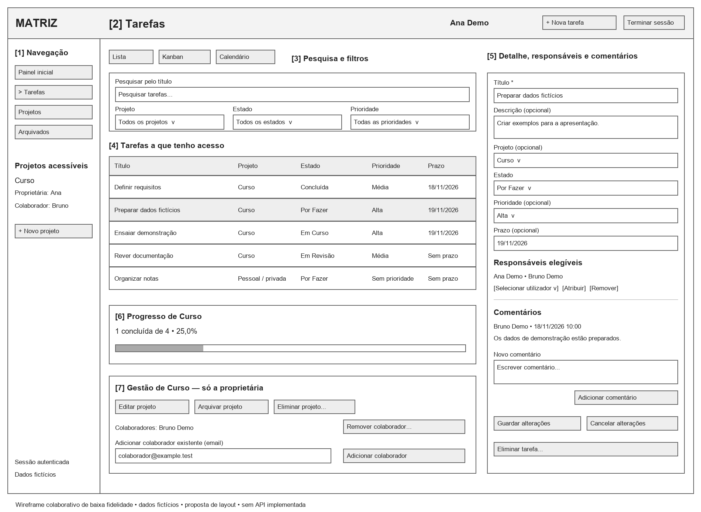
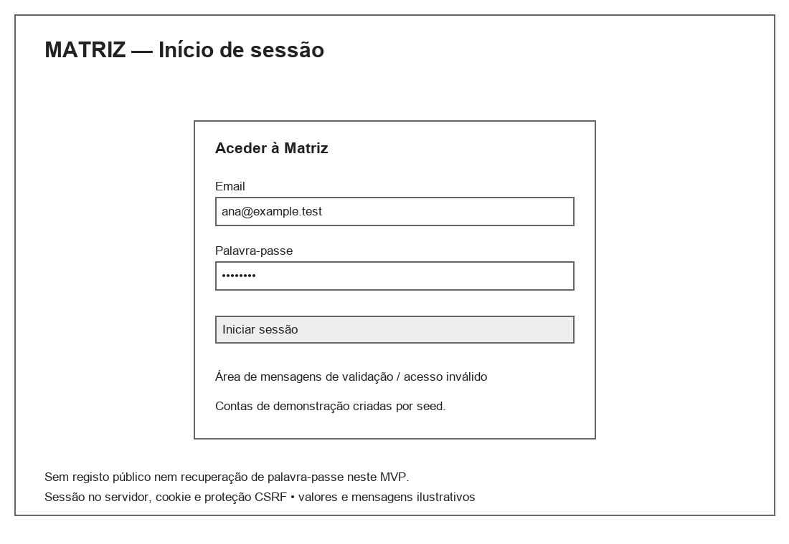

# Matriz — Wireframes colaborativos

**Versão:** 2.0, 18/11/2026. **Estado:** layout revisto para COL-01, proposto para revisão. A aprovação UI-01 refere-se à versão individual preservada no histórico, não à nova disposição dos elementos colaborativos.

## Ecrã principal — Tarefas e colaboração

### Implementação visual atual — modernização de 19/11/2026

Após o pedido de refatoração visual, a SPA utiliza menu lateral Painel/Projetos/Tarefas (navegação superior no móvel), conta no cabeçalho e conteúdo central. Painel com contagens, projetos/progresso e tarefas com filtros e cartões. Rastreabilidade funcional e regras de acesso abaixo mantidas; os wireframes anteriores são evidência conceptual, não capturas da nova disposição.

[Login atual](frontend-moderno-login.png) · [Painel atual](frontend-moderno-painel.png) · [Projetos atuais](frontend-moderno-projetos.png) · [Tarefas atuais](frontend-moderno-tarefas.png) · [Móvel a 360 px](frontend-moderno-movel.png). [Descrição e resultados](../frontend-modernization.md).

O utilizador apreciou positivamente o resultado («parece me muito melhor») e autorizou documentação, testes e integração. Esta apreciação não equivale a auditoria integral de acessibilidade nem a aceitação funcional humana exaustiva.

Objetivo: consultar trabalho autorizado, editar tarefas, atribuir responsáveis e comentar. A tarefa selecionada pertence ao projeto Curso, de Ana (proprietária), partilhado com Bruno. A última linha é tarefa pessoal de Ana, não visível a Bruno. Os dados são fictícios.

| Área | Propósito | Rastreabilidade |
|---|---|---|
| 1 | Painel, tarefas, projetos e arquivo; só projetos acessíveis. | US-02/06/12/22; F01/F05/F09/F19 |
| 2 | Utilizador autenticado, terminar sessão e nova tarefa. | US-03/15; F02/F12 |
| 3 | Vistas lista/Kanban/calendário e filtros/pesquisa no conjunto autorizado. | US-06/07/08/14; F05/F11 |
| 4 | Tarefas autorizadas, incluindo independentes privadas do criador. | US-04/06/16; F02/F05/F13 |
| 5 | Dados, associação, estado, prazo/prioridade, responsáveis e comentários. | US-04/05/10/18/19; F02/F03/F06/F08/F15/F16 |
| 6 | Progresso derivado: 1 concluída em 4 do projeto, sem contar tarefa privada. | US-09; F07 |
| 7 | Ações do proprietário, colaboradores existentes, adicionar/remover e eliminar projeto. | US-02/12/17/20; F01/F09/F14/F17 |

A área 7 só aparece para o proprietário; ocultar controlos não substitui autorização do backend. Um colaborador mantém as ações de tarefas/comentários/responsáveis e não as de gestão do projeto. Projetos arquivados são apresentados num destino separado, em leitura; proprietário pode restaurar ou eliminar o projeto, mas as tarefas/dependentes não admitem alterações durante arquivo.

## Ecrã de início de sessão

Suporta US-15: email/palavra-passe de demonstração, validação, submissão, acesso inválido e encaminhamento para painel após sucesso. Não mostrar hash nem registo/recuperação fora do âmbito. Sessão expirada apresenta mensagem compreensível e regressa a este ecrã.

## Fluxos e regras

- Projeto: criar com nome/descrição; backend determina proprietário. Pesquisar pelo nome e consultar detalhe em destino ainda não desenhado.
- Tarefa: criar com título obrigatório, estado Por Fazer se omitido e projeto opcional. Independentemente do formulário, backend verifica identidade, referências e arquivo.
- Associar/transferir exige acesso atual e destino autorizado; desassociar torna privada do criador original e pode retirar acesso ao ator. Avisar desse efeito na interação.
- Responsáveis: listar elegíveis, adicionar vários sem duplicação e remover um par. Atribuições inelegíveis após transferência/remoção de colaborador são removidas na mesma operação atómica.
- Comentário: conteúdo não vazio, autor/data do backend; leitura apenas com acesso. Eliminar tarefa/projeto elimina comentários dependentes; não existe edição/eliminação individual de comentários.
- Eliminar projeto: confirmação deve enumerar projeto, tarefas, comentários e atribuições, sem apagar utilizadores. Cancelar não envia pedido; eliminação de tarefa também exige confirmação.
- Sem resultados/erro/carregamento/sucesso são estados previstos. Preservar formulário em falha, não duplicar submissão em curso e só atualizar com sucesso confirmado.
- Filtros por interseção, incluindo Sem projeto e Sem prioridade; vistas reutilizam os mesmos dados. Tarefas sem prazo não aparecem no calendário. Contagens respeitam o conjunto autorizado completo, não só linhas visíveis.

## Destinos não desenhados e pendências

Painel inicial (utilizador, projetos acessíveis e contagens por estado), lista/pesquisa de projetos, detalhe completo, Kanban, calendário, arquivo e confirmações são destinos/variantes descritos, não protótipos concluídos. O painel pode dar acesso ao detalhe dos projetos/tarefas. A composição exata das contagens deve ser confirmada no contrato; não apresentar dados globais de utilizadores sem acesso.

Layout, mensagens, adaptação móvel, teclado, limites de texto, ordem inicial e navegação do calendário necessitam de desenho/verificação posteriores. São propostas de interface; não se declara acessibilidade, usabilidade ou aplicação validada.

## Artefactos e fontes

- docs/ui/wireframe-tarefas.png e este documento.
- docs/ui/wireframe-login.png.
- [Requisitos](../requirements.md), [User Stories](../user-stories.md), [Restrições](../constraints.md), [Modelo](../database.md), [Arquitetura](../architecture.md), [OpenAPI](../../openapi.yaml).
- [Reconciliação](../scope-reconciliation.md), [Log da ficha 3](../ai-logs/ficha-03.md).

Imagens monocromáticas de baixa fidelidade, sem identidade visual final, ligação à API ou dados reais. PNGs de tarefas e login abertos e inspecionados: texto legível, sem cortes/sobreposições relevantes; seleção, projeto e progresso coerentes com os dados fictícios. Não são testes de usabilidade ou de aplicação.

## Atualização aprovada — Exercício 5 (TAR-01/PESQ-02)

Os estados técnicos ativos passam a TODO/IN_PROGRESS/DONE (rótulos Por fazer/Em curso/Concluída), com inicial TODO; prioridades LOW/MEDIUM/HIGH (Baixa/Média/Alta) ou null. Em novas tarefas prioridade omitida = MEDIUM; null explícito = Sem prioridade. As referências anteriores aos quatro estados/prioridades ficam superadas por esta decisão humana, sem alterar cardinalidades nem remover tarefas pessoais COL-04.

A V2 incremental converte Por Fazer→TODO, Em Curso/Em Revisão→IN_PROGRESS, Concluída→DONE, Baixa→LOW, Média→MEDIUM, Alta/Crítica→HIGH; conserva prioridades null preexistentes, IDs, criador, comentários e atribuições. PESQ-02 confirma pesquisa literal parcial de tarefas ignorando maiúsculas e acentos.

Lista/CRUD/filtros e transferências de tarefas implementados com autorização, CSRF e transações; COL-06 remove atribuições inelegíveis na mesma operação. Progresso calcula tarefas DONE/total. Escrita de comentários/responsáveis, gestão de colaboradores, painel, Kanban e calendário continuam pendentes. Ver [tarefas](../tasks.md), OpenAPI 0.5.0 e verification.md para o estado observado.

## Atualização — Exercício 6

Responsáveis/elegíveis e comentários integrados na API e no detalhe da tarefa, mantendo o modelo de seis entidades e V1/V2. COM-01: novos comentários de 1–2000 pontos de código Unicode, não só espaços; autor/data do backend; ordem criadoEm/id ASC. Responsáveis múltiplos com par único, remoção individual e elegibilidade revalidada no backend. Arquivo bloqueia escritas; pessoais privadas. Contratos/limites em [task-collaboration.md](../task-collaboration.md). As menções anteriores a escrita de comentários/responsáveis pendente ficam superadas por este incremento; gestão de colaboradores, painel e Kanban/calendário continuam pendentes. Ver verification.md para evidências, sem confundir plano com teste executado.

## Atualização — Exercício 7

Colaboradores (US-17), painel (US-22), Kanban (US-07) e calendário (US-08) integrados na interface/API. PAINEL-01 inclui pessoais + projetos ativos acessíveis na UI, exclui arquivo, não depende dos filtros da lista. COL-07 permite ao proprietário gerir colaboradores mesmo arquivado; remoção limpa atribuições atomicamente e conserva autoria/contas. Tarefas arquivadas continuam protegidas contra escrita. Modelo/stack/V1/V2 preservados; OpenAPI 0.7.0 com 24 operações implementadas. As referências anteriores a estas funcionalidades pendentes ficam superadas por este incremento. Ver [integração](../frontend-integration.md) e verification.md para resultados/limites; entrega final/CI não declaradas concluídas.

### Capturas da implementação — Exercício 7

Capturas de testes com fixtures fictícias próprias, inspecionadas visualmente; não substituem o wireframe conceptual. A interface atual usa três estados TAR-01 e calendário móvel com agenda legível.

[Kanban desktop](frontend-kanban-desktop.png) · [Calendário móvel (360 px)](frontend-calendar-mobile.png)
